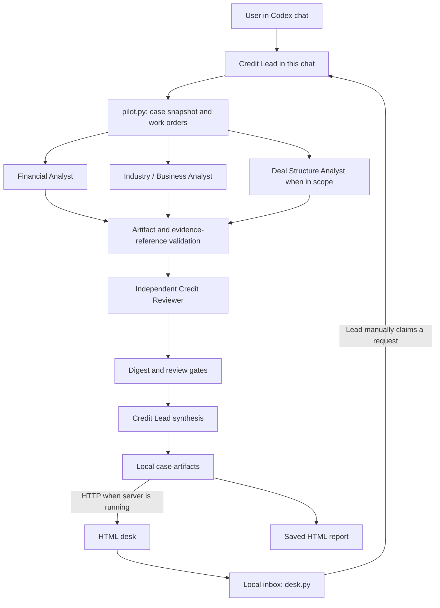
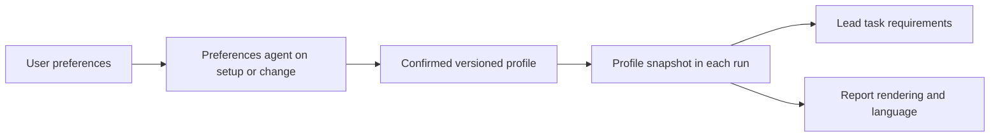
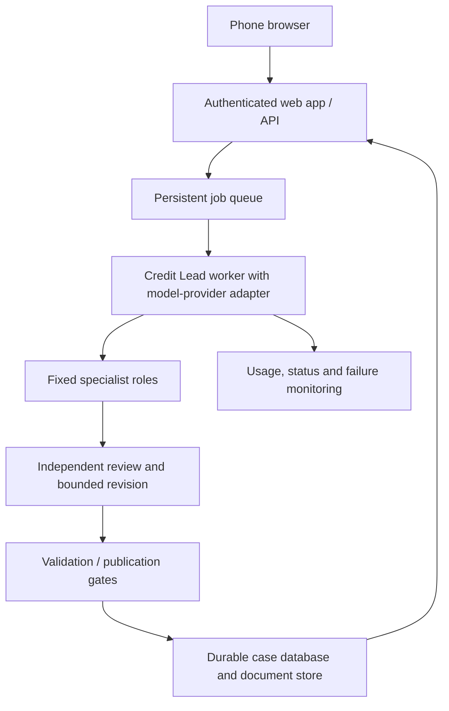

# Credit Pilot architecture

As of 2026-10-18. Follow [PROJECT.md](../PROJECT.md) for status, branch and priorities.

## Current implementation

The Web → Lead step requires a request to the active Codex chat. `desk.py` never invokes model APIs or wakes this chat. Analysts use independent first-pass contexts. The reviewer sees their artifacts and original evidence; findings require known evidence references. A blocked review stays blocked in the published status. A passed review permits a limited memo despite explicitly disclosed evidence gaps; it does not confer a rating.

## Code and state

| Location | Responsibility |
| --- | --- |
| `engine/pilot.py` | Input/role snapshots, work orders, analyst validation, review packet digest, final memo |
| `engine/desk.py` | Persistent inbox, claim/reply/publication CLI, HTTP API and web assets |
| `engine/roles/` | Analyst and independent reviewer instructions |
| `engine/MODEL_POLICY.md` | Session model defaults and escalation |
| `web/` | Case list, source text submission, separate results, lead summary and case messages |
| `engine/desk-data/` | Ignored local source evidence, jobs, run artifacts and execution records |

A case run captures its input and role instructions. The bridge records execution model choices manually when delegated. A full configuration/prompt-version registry, token/cost meter and durable shared storage are not implemented. A new chat must inspect which artifacts it actually has; a repository connection alone cannot restore ignored run files.

## Proposed customization path

Profile presentation fields: output language, bilingual output if requested, section order, audience, detail and units. Scope fields: issuer versus instrument, time horizon and requested questions. Methodology fields need their own evaluated versions and cannot be created by a formatting preference. Profiles are proposed data, not arbitrary executable instructions. Evidence dates, gaps and reviewer blockers remain mandatory in all outputs. Reformatting a valid case should reuse its reviewed analysis instead of paying for all specialists again. Any materially new analytical claims need new review.

## Proposed hosted pilot

This is a target design, not deployed infrastructure. Production workers require configured model access; access through this Codex session is not automatically a website credential. Keep the provider adapter configurable so session-specific model names can map to models actually available in the chosen account.

For a private pilot, add identity and per-case access checks, protected document storage, resumable jobs, timeouts, idempotency, a per-case spend limit and a recovery path. Preserve snapshots and publication gates. Initial release scope should be credit research with human sign-off. Formal rating output remains a separate methodology and evaluation project.

## Phone workflow

Use the phone to set scope, review results, approve changes and follow links. Build, test, run agents and store data in cloud services. A shareable authenticated URL and durable case history replace dependence on one ephemeral task process. Hosting/provider setup may require a mobile browser outside the Codex app; no exact app-only capability is assumed here.
